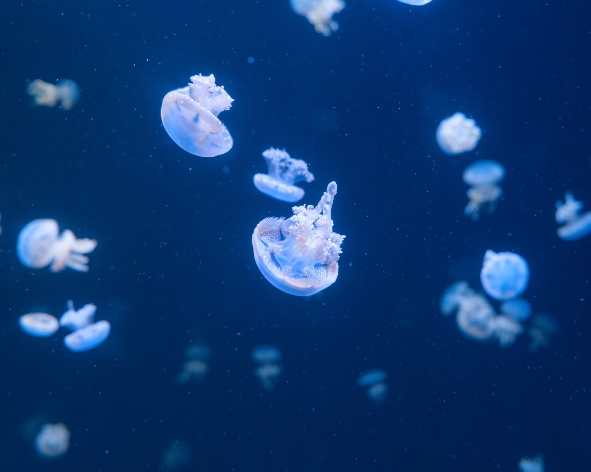
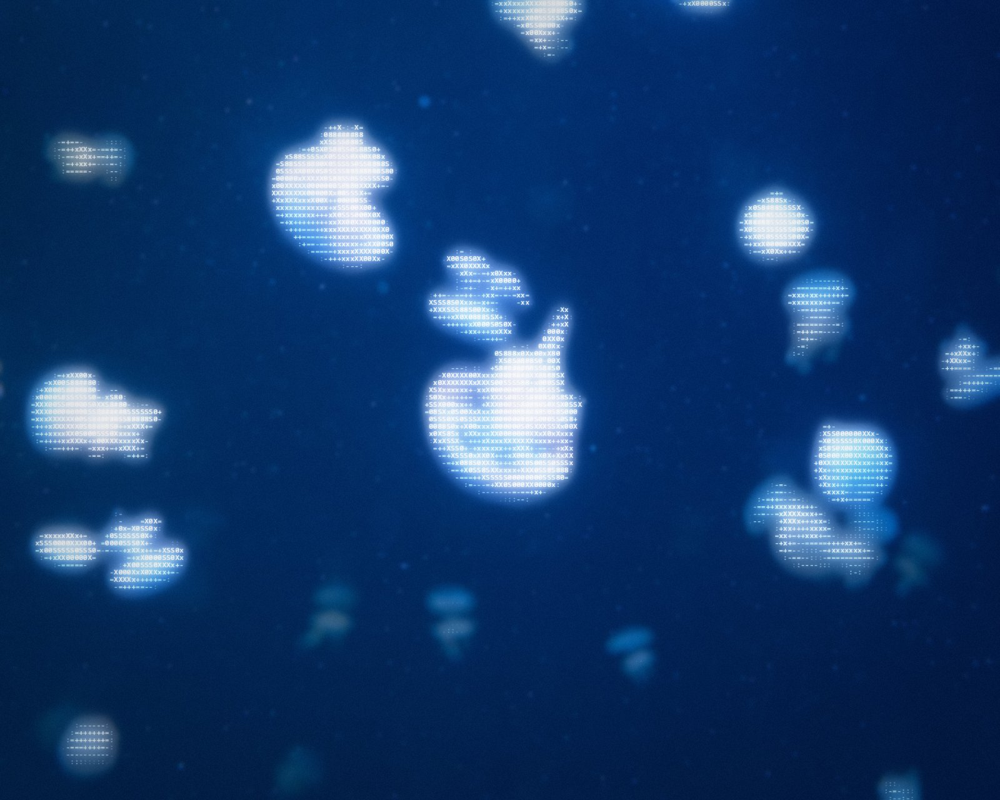
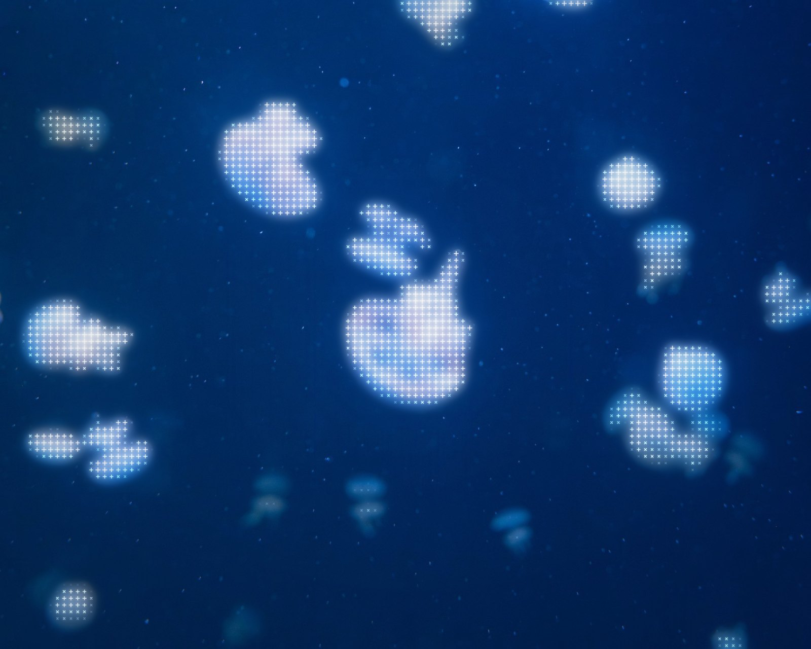
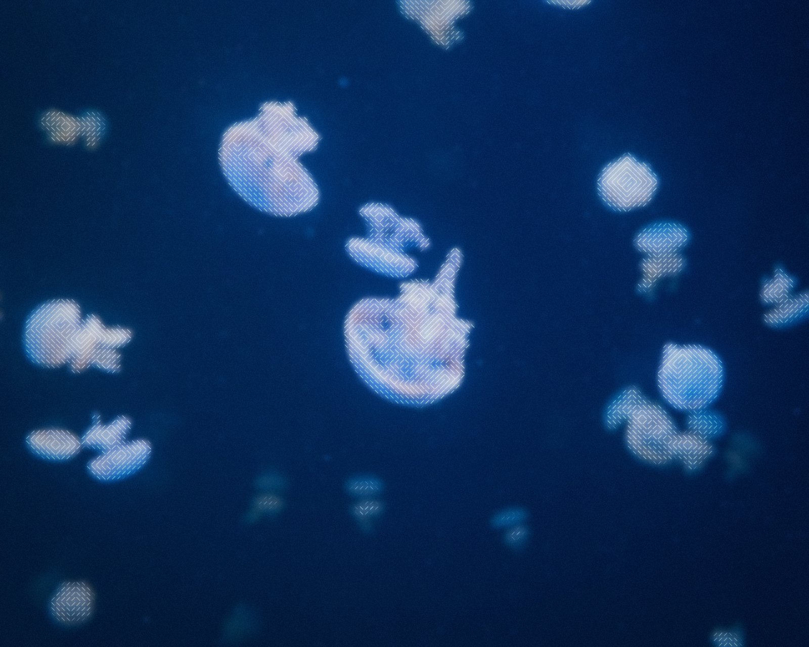
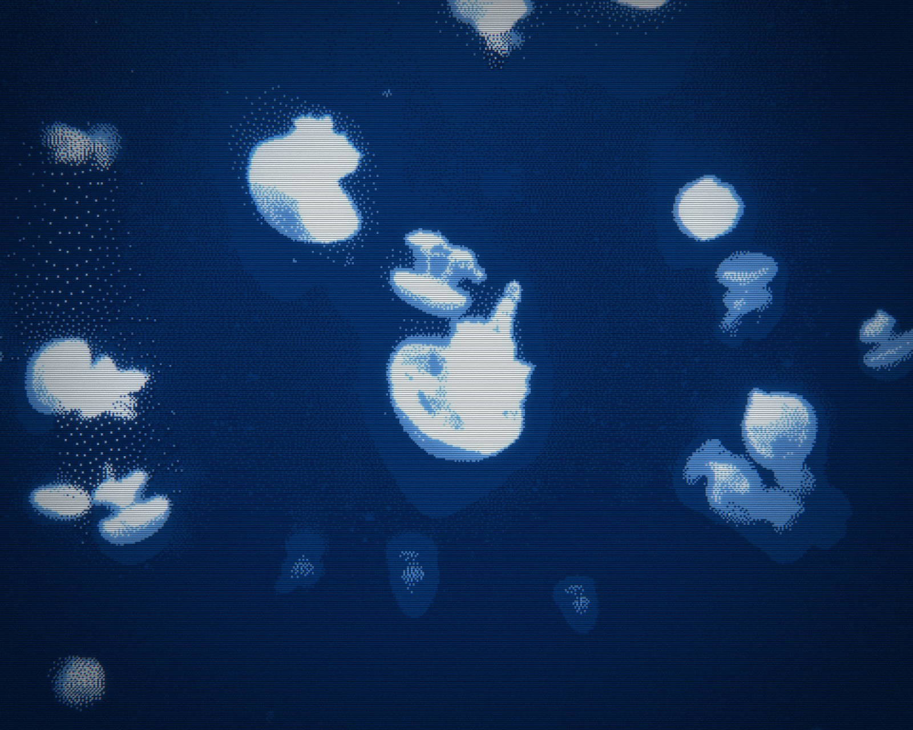
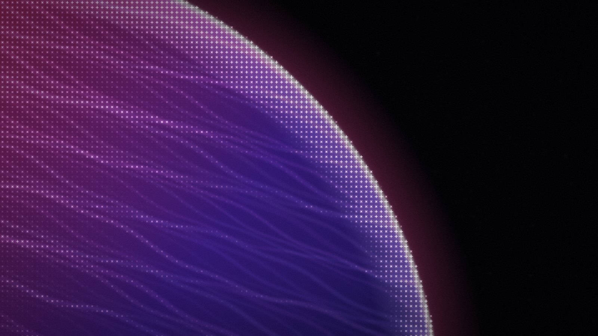
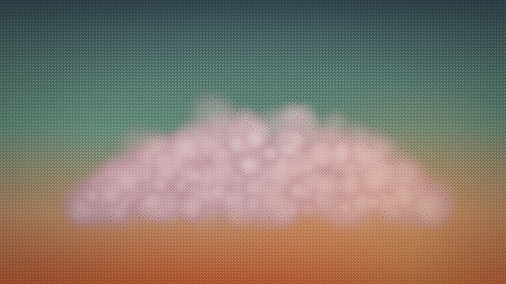
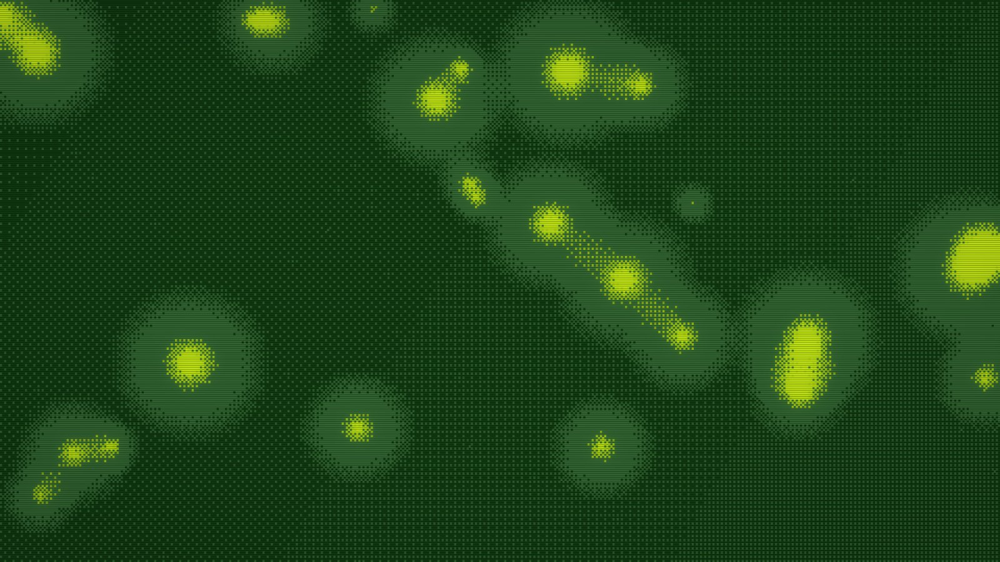

# ascii-maker

Turn photos into ASCII, cross-stitch, hatching, halftone and dithered art, with bloom, scanlines and film effects. Everything is algorithmic image processing: no AI or generative models. One engine (`src/engine/`) powers a browser editor and a Node CLI.

**[Open the editor →](https://xiaoyu-ben-wang.github.io/ascii-maker/)** (runs entirely in your browser; images never leave your machine)

| Original | `soft-ascii` |
| --- | --- |
|  |  |

| `cross` | `diagonal` | `dither-scanline` |
| --- | --- | --- |
|  |  |  |
|  |  |  |
| `cross` | `diagonal` | `gameboy-dither` |

**Contents:** [Quick start](#quick-start) · [Using the editor](#using-the-editor) · [Styles and presets](#styles-and-presets) · [Where glyphs appear](#where-glyphs-appear) · [Background](#background) · [Effects](#effects) · [Command line](#command-line) · [How it works](#how-it-works) · [Development](#development)

## Quick start

**In the browser:** open the [editor](https://xiaoyu-ben-wang.github.io/ascii-maker/), click **Open** (or drop or paste an image), pick a preset at the top of the right panel, and press **Export**.

**Locally:**

```bash
pnpm install
pnpm dev                                                   # editor at http://localhost:5173
node cli/ascii-maker.ts photo.jpg -p soft-ascii -o out.png # command line
```

The CLI needs Node 23.6 or newer (it runs the TypeScript directly).

## Using the editor

### Loading images

Open (`Ctrl+O`), drag and drop, or paste (`Ctrl+V`) one image or many. **Samples** loads the example photo and three procedural scenes, and the example tiles on the start screen open a photo with its preset. Every loaded image shares the same settings, so you can tune a look once and export a whole batch.

- **Single** view shows one image large. With more than one image a filmstrip appears at the bottom: click a thumbnail to switch (or use `←` / `→`), hover it and click × to remove it, or click **+** to add more.
- **All** view (`G`) renders every image side by side at the size it is shown. Hover a card and click × to remove it.

### Moving around the preview

| Input | Does |
| --- | --- |
| Mouse wheel | Zoom in and out around the pointer (up to 8×) |
| Trackpad two-finger scroll | Pan while zoomed in (scrolls the page at 1×) |
| Trackpad pinch, `Ctrl` + wheel, or two-finger pinch on touch screens | Zoom |
| Drag with the mouse, or one finger on touch screens | Pan while zoomed in |
| Double-click or double-tap | Toggle between fit and 2.5× zoom |
| The zoom badge (bottom right) | Reset to fit |

A mouse wheel and a trackpad both send "wheel" events, so the editor tells them apart by their pattern: a mouse moves in whole notches, a trackpad in small steps that often include some sideways motion. Zoomed in, the preview re-renders at higher resolution so glyphs stay sharp.

### The settings panel

Pick a preset from the menu at the top, then adjust the sections below it. Hover any label to see what it does; a dot and a reset arrow mark values you changed from the preset, and double-clicking a slider label resets it. Undo and redo (`Ctrl+Z` / `Ctrl+Shift+Z`) cover every setting change.

| Section | What it controls |
| --- | --- |
| **Highlight styling** | The style (ASCII, cross, diagonal, dots, lines, dither), cell size, character set, and which parts of the image get glyphs (coverage, threshold, fade-in, what counts as bright). For dither: algorithm, palette, color count, pixel size |
| **Glyph color** | Source colors or one mono color, whitening, brightness, opacity and softness of the glyphs |
| **Background image** | The photo under the glyphs: opacity, blur, fill color, and dimming or blurring only near the glyphs |
| **Glow, Scanlines, Vignette, Color fringe, Grain, Blur** | Post effects; each has an on/off switch |
| **Adjust photo** | Brightness, contrast, saturation, gamma and invert, applied before anything else |
| **Advanced** | Font, random seed, and the unit width that sizes are measured against |

Your current preset and settings are remembered in the browser between visits. Images and painted masks are not saved.

### Painting where glyphs go

The mask brush (`M`, or the brush button in the top toolbar) lets you overrule the threshold by hand:

- **Add** (`A`, green) forces glyphs onto an area, even a dark one. Forced cells still choose their glyph by their own brightness, so dark areas get light characters.
- **Remove** (`R`, red) keeps glyphs off an area, however bright.
- **Erase** (`E`) returns an area to normal.

Set the brush size with the slider or `[` / `]`. The eye button hides the colored overlay so you can judge the result, `Ctrl+Z` undoes the last stroke, the trash button clears the mask, and **Done** (or `M` / `Esc`) leaves the brush. Each image has its own mask, a dot on the brush button shows the current image has one, and exports use it. While painting, a drag paints instead of panning; zoom with the wheel or a pinch and pan with a trackpad or two fingers. On touch screens a two-finger pinch cancels the stroke the first finger started. The brush works with the glyph styles, not with `dither` or `photo`.

### Comparing and exporting

Press `\` (or the split button) for a before/after divider you can drag, or hold `B` to see the original.

**Export** saves the current image; **Export all** saves every image as a `.zip`. Choose PNG, JPEG or WebP, at the original resolution or with the long edge at 1080p (1920 px), 2K (2560 px) or 4K (3840 px). The options menu next to Export also has **Copy CLI command** and **Save params JSON**, which carry the current look over to the command line.

### Keyboard shortcuts

| Key | Action |
| --- | --- |
| `Ctrl+O` / `Ctrl+V` | Open / paste images |
| `Ctrl+S` / `Ctrl+Shift+S` | Export / export all |
| `Ctrl+Z` / `Ctrl+Shift+Z` | Undo / redo (undoes brush strokes while the mask brush is on) |
| `G` | Single / All view |
| `←` / `→` | Previous / next image |
| `\` | Before/after split |
| Hold `B` | Show the original |
| `M` | Mask brush on/off; then `A` add, `R` remove, `E` erase, `[` / `]` size |
| `Esc` | Leave the mask brush or the vignette picker |

## Styles and presets

| Style | What it draws |
| --- | --- |
| `characters` | Characters from a set ordered dark to bright |
| `cross` | `+` on bright cells, small `×` on faint ones, sized by brightness |
| `diagonal` | `/` `\` strokes: `edge` follows contours, `forward` / `backward` hatch in parallel, `mixed` is random |
| `dots` | Halftone circles that grow with brightness |
| `lines` | Vertical strokes |
| `dither` | The whole image reduced to a palette with a dither pattern |
| `photo` | No glyphs: the photo itself, with the adjustments and post effects (the `scanlines` preset) |

| Preset | Look |
| --- | --- |
| `soft-ascii` | Glowing ASCII on the highlights, over a softened copy of the photo |
| `sharp-ascii` | The same over the sharp photo, softened and dimmed only around the glyphs |
| `cross` | Cross-stitch `+` and `×` marks that grow with brightness |
| `diagonal` | Hatched slashes that follow the edges, warm film look |
| `dots` | Halftone dots that scale with brightness |
| `full-ascii` | Classic ASCII art: every cell is a character, in the source colors on black |
| `full-cross` | The whole image rebuilt from `+` and `×` marks |
| `dither-scanline` | Chunky Floyd–Steinberg dither with CRT scanlines and bloom |
| `gameboy-dither` | Ordered Bayer dither in the 4-tone Game Boy palette |
| `dither` | Plain Floyd–Steinberg dither in colors picked from the image |
| `scanlines` | The photo with CRT scanlines |
| `matrix` | Green mono ASCII on black |

**Character sets** (`characters` style): pick one in the editor or by name with `--charset`, or type your own characters from dark to bright.

| Name | Characters |
| --- | --- |
| `standard` | `` .:-=+xX0S8#@`` |
| `classic` | `` .:-=+*#%@`` (the 10-step ramp from classic ASCII art) |
| `mixed` | `` .:-=+*xX0S8#%@`` (standard and classic merged) |
| `detailed` | 70 characters, the finest tonal steps |
| `letters` | Letters and digits, looks like text |
| `blocks` | `` ░▒▓█`` |
| `braille` | Braille dots that fill in with brightness |
| `dots` | `` .·•●`` |
| `binary` | `` 01`` |

**Dither algorithms:** Floyd–Steinberg, Atkinson, Jarvis, Stucki, Burkes, Sierra (three variants), Bayer 2/4/8/16, clustered-dot halftone, interleaved-gradient noise, line patterns and random noise. **Palettes:** `auto` (colors picked from the image; the count is the Colors setting), `source` (levels per channel), `mono`, `gameboy`, `c64`, `pico8`, `cga`, `amber`, `synthwave`, `ocean`, or your own list such as `#000,#f0f,#0ff`.

## Where glyphs appear

With **Coverage: highlights** (the default), glyphs are drawn only on cells brighter than the **Threshold**, and **Fade-in** lets them grow in gradually just above it instead of popping in. **Bright means** decides what "brighter" is measured against:

- **absolute**: the cell's own brightness. Simple, but a bright photo can end up covered in glyphs.
- **relative**: the cell's rank within the image, so the threshold becomes the share left bare (`0.7` puts glyphs on the brightest 30%).
- **local**: the cell compared with its surroundings (**Surroundings** sets how far), so flat bright areas such as sky stay bare while edges and details light up.

**Coverage: full** puts a glyph on every cell and ignores the threshold; pair it with background opacity 0 for classic ASCII art, as `full-ascii` and `full-cross` do. For anything the threshold gets wrong, paint over it with the [mask brush](#painting-where-glyphs-go).

## Background

Glyph styles draw over a copy of the photo:

- **Opacity** fades the whole photo toward the **Fill color** (black by default); 0 leaves only the fill.
- **Blur** softens the whole photo.
- **Dim near glyphs** and **Blur near glyphs** do the same only around the glyphs, so the glyphs stand out while the rest of the photo stays bright and sharp. **Spread** sets how far around the glyphs that reaches, in cells. Combine them freely: blur alone gives a glowing look, dim alone a dark outline, both a soft shadow. The highlight presets (`sharp-ascii`, `cross`, `diagonal`, `dots`) use both, at blur 14 and dim 0.45, with the photo otherwise at full opacity; `soft-ascii` uses the blur only.

## Effects

Applied after the glyphs, in this order:

| Effect | Does |
| --- | --- |
| Blur | Blurs the finished image |
| Glow (bloom) | Halo around bright glyphs (or bright pixels for dither and photo) |
| Color fringe | Shifts red and blue apart toward the edges, like a cheap lens |
| Scanlines | Dark horizontal CRT lines |
| Vignette | Darkens toward the edges; pick its center on the image |
| Grain | Film noise |

There are three kinds of blur: the background blur (under the glyphs), glyph softness (the glyphs only) and the Blur effect (everything).

Sizes such as cell size, blur and glow radius are measured on a 1920 px-wide image and scale with the output, so a 4K export looks like the preview, only sharper. Set **Unit width** to 0 to use absolute pixels.

## Command line

```bash
node cli/ascii-maker.ts photo.jpg -p soft-ascii -o out.png
node cli/ascii-maker.ts photo.jpg -p dither-scanline --dither-algo atkinson --palette pico8 -o out.png
node cli/ascii-maker.ts photo.jpg --style cross --cell-size 18 --bloom 0.8 --size 4k -o out.jpg
node cli/ascii-maker.ts photo.jpg -p sharp-ascii --bg-opacity 1 --halo-dim 0.45 --halo-blur 14 -o out.png
node cli/ascii-maker.ts photo.jpg -p soft-ascii --mask mask.png -o out.png
node cli/ascii-maker.ts photos/*.jpg -p diagonal --size 1080p -o out/     # batch into a folder
node cli/ascii-maker.ts clip.mp4 -p soft-ascii --size 1080p -o clip-ascii.mp4
node cli/ascii-maker.ts photo.jpg -c params.json --text out.txt -o out.png --json
node cli/ascii-maker.ts --list        # presets, styles, character sets, dither algorithms, palettes
node cli/ascii-maker.ts --help        # every flag with its range and default
```

Every editor setting is also a flag, in kebab-case (`cellSize` → `--cell-size`). Settings apply in this order: defaults → `--preset` → `--config` JSON (e.g. one saved from the editor) → individual flags.

| Option | Does |
| --- | --- |
| `-o, --out` | Output file (format from its extension), or a folder for a batch |
| `-p, --preset` / `-c, --config` | Start from a preset / a params JSON file |
| `-s, --size` | `source` (default), `1080p`, `2k`, `4k` (long edge 1920 / 2560 / 3840) |
| `-w, --width` | Exact output width, keeping the aspect ratio |
| `-f, --format` | Batch output format: `png`, `jpg`, `webp`; for video `mp4`, `webm`, `gif` |
| `--mask` | Highlight mask image, stretched over each input: white forces glyphs, black keeps them off, mid-gray (128) and transparent areas leave the image alone. Glyph styles and images only |
| `--text` | Also write the plain character grid (`characters` style) |
| `--quality` | JPEG/WebP quality, 0–100 (default 92) |
| `--json` | Print a machine-readable summary per file |
| `--dump-params` | Print the resolved settings and exit |

Out-of-range or unknown values fail with a clear error, which makes the CLI easy for scripts and agents to drive.

### Video

Video inputs (`.mp4 .mov .mkv .webm .avi .m4v .gif`) are decoded with ffmpeg (on `PATH` or `FFMPEG_PATH`), rendered on all CPU cores, and encoded to mp4 (H.264), webm (VP9) or gif, keeping the audio. Flags: `--fps`, `--start`, `-t/--duration`, `--crf`, `--threads`, `--no-audio`. Film grain changes every frame, and the `auto` dither palette is fixed from the first frame so colors don't flicker.

A 30 s 1080p clip (900 frames) takes about 32 s for `soft-ascii` and 34 s for `dither-scanline` on a Ryzen 7 9800X3D. The editor doesn't decode or encode video yet.

## How it works

Every render runs the same pipeline (`src/engine/render.ts`), in floating point with each color channel from 0 to 1.

1. **Adjust.** Invert, saturation, contrast, brightness and gamma are applied to the source.

2. **Cell grid.** The image is divided into cells. The cell height is the cell size scaled by output width ÷ unit width, so the look doesn't change with resolution. Characters use cells 0.6 as wide as they are tall (the shape of a monospace glyph); the other styles use squares. Each cell's color is the average of the pixels it covers.

3. **Brightness per cell.** Each cell's luminance (Rec. 709 weights) is turned into a highlight level according to **Bright means**: used as is (absolute); replaced by its rank among all cells (relative); or compared with a blurred copy of the luminance grid as 0.25 × luminance + 2.5 × (luminance − surroundings), so a cell counts as bright when it stands out from its neighborhood (local).

4. **Glyph strength and choice.** A cell's opacity is a smoothstep from the threshold to threshold + fade-in × (1 − threshold), so glyphs fade in rather than switch on. Its level above the threshold, rescaled to 0–1, picks the glyph: an index into the character set, the arm length of a cross, the radius of a dot, the length of a stroke. In full coverage the threshold is 0 and the whole character set (including its leading space) spans the brightness range. A painted mask is sampled at each cell center: adding raises the opacity up to the glyph opacity setting and lets the glyph follow the cell's own brightness; removing scales the opacity down to zero.

5. **Drawing glyphs.** Each distinct glyph shape is drawn once on a canvas into an alpha mask (an atlas), with sizes rounded to 24 steps so a handful of masks cover every brightness. Every cell then stamps its mask into a glyph layer in plain JavaScript, which is much faster than drawing thousands of shapes through the canvas. The glyph color is the cell color (or the mono color), mixed toward white by **Whiten** and multiplied by **Brightness**. **Diagonal** in `edge` mode runs a Sobel filter over a smoothed luminance grid and draws each stroke along the edge, perpendicular to the gradient.

6. **Background.** The photo is blurred (a three-pass box blur that approximates a Gaussian, run on a downscaled copy for large radii) and mixed toward the fill color by the opacity. For **Dim / Blur near glyphs**, the grid of glyph opacities is blurred by the spread (in cells), scaled up to the image, and used as a mask: inside it the photo is mixed toward a more blurred copy and toward the fill color.

7. **Composite.** The glyph layer (optionally softened) is blended over the background by its alpha.

8. **Dither** (instead of steps 2–7). The image is pre-blurred and shrunk to the pixel size, so each block averages its pixels instead of sampling one, then reduced to the palette. Error-diffusion algorithms carry each pixel's rounding error to its unprocessed neighbors with their own weights (Floyd–Steinberg: 7/16 right, 3/16, 5/16 and 1/16 on the next row). Ordered algorithms compare each pixel with a repeating threshold matrix (Bayer) or pattern. **Strength** scales the error or pattern. The `auto` palette runs k-means clustering on the image colors. The result is scaled back up with hard pixel edges.

9. **Post effects**, in the order listed under [Effects](#effects). Glow keeps the parts above its threshold, blurs them at two radii (a tight halo plus a wide haze, at half resolution) and adds them back through a soft shoulder curve, so blown highlights roll off smoothly instead of clipping. For glyph styles the glow comes from the glyph layer only, so the background doesn't bloom.

**Speed.** In the editor, rendering runs in Web Workers. One worker holds the full-resolution images for the preview and exports, and a small pool renders the All-view thumbnails in parallel from downscaled copies. While a slider moves, the editor first renders a half-resolution draft, then the full preview once you stop; intermediate results (adjusted image, blurred background, cell averages) are cached, so changing a glyph setting doesn't redo the blurs. The CLI runs the same engine on `@napi-rs/canvas`, and spreads video frames across worker threads.

## Development

```bash
pnpm test        # node:test suite (engine, zip, CLI)
pnpm typecheck
pnpm bench out/photo.jpg   # preview-size render timings per preset
pnpm build       # static site in dist/
node scripts/examples.ts --photo your-photo.jpg   # regenerate the example images
```

The planet, clouds and orbs scenes are procedural (`src/samples/scenes.ts`). The editor is built with React, [Radix UI](https://www.radix-ui.com/) primitives and Tailwind CSS, and is deployed to GitHub Pages by `.github/workflows/pages.yml` on every push to `main`.
