# ascii-maker

Turns photos and videos into ASCII art, cross-stitch, hatching, halftone dots and dithered pixel art. It runs as an editor in the browser and as a command-line tool, and both use the same rendering code. No AI models are involved; every look is a fixed image-processing pipeline.

**[Open the editor](https://xiaoyu-ben-wang.github.io/ascii-maker/)**. Images are processed locally and never uploaded.

| Photo | `soft-ascii` preset |
| --- | --- |
| 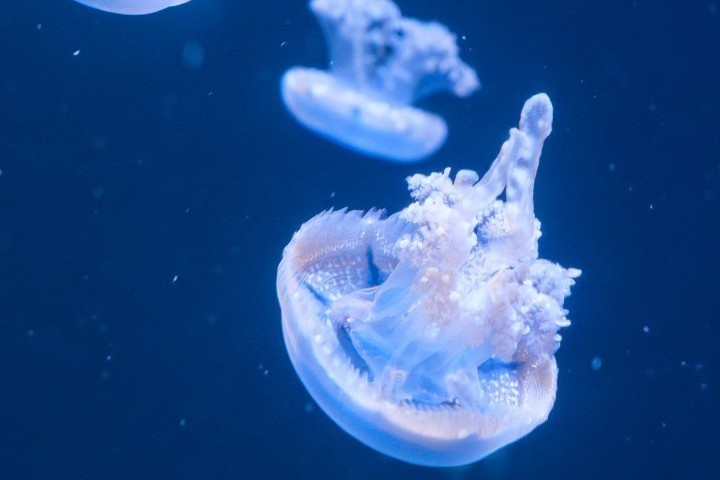 |  |

## Examples

Crops at full resolution from 1920 px renders, each one preset with no changes. Full-size versions are in [`public/examples/`](public/examples).

| `cross` | `diagonal` |
| --- | --- |
| 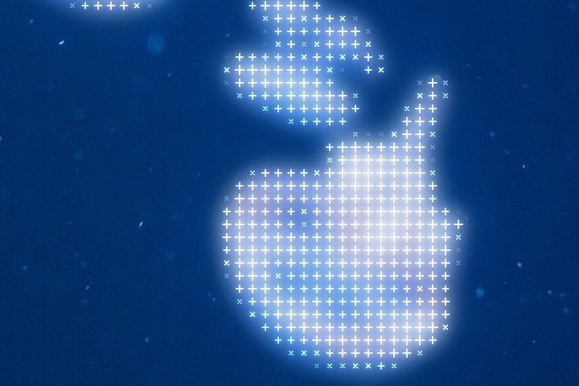 |  |
| **`dither-scanline`** | **`ascii-surround`** |
| 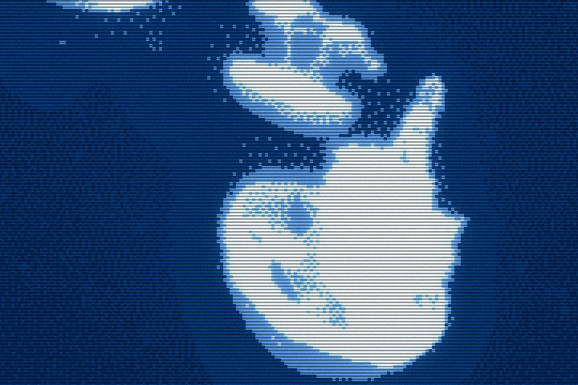 | 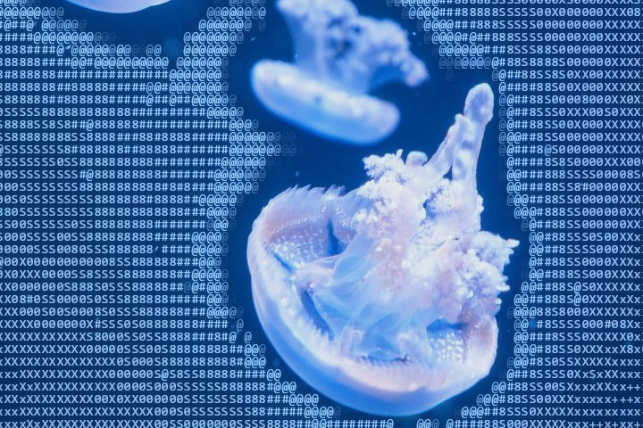 |
| **`cross`** | **`dots`** |
| 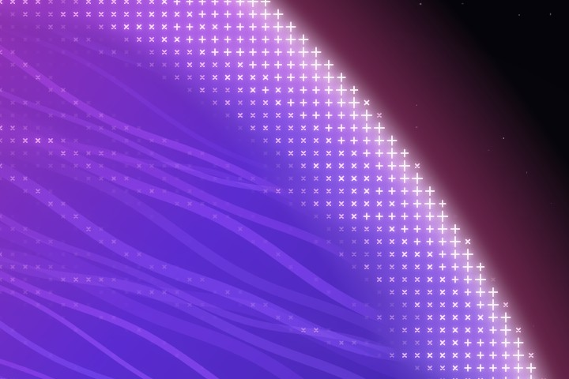 | 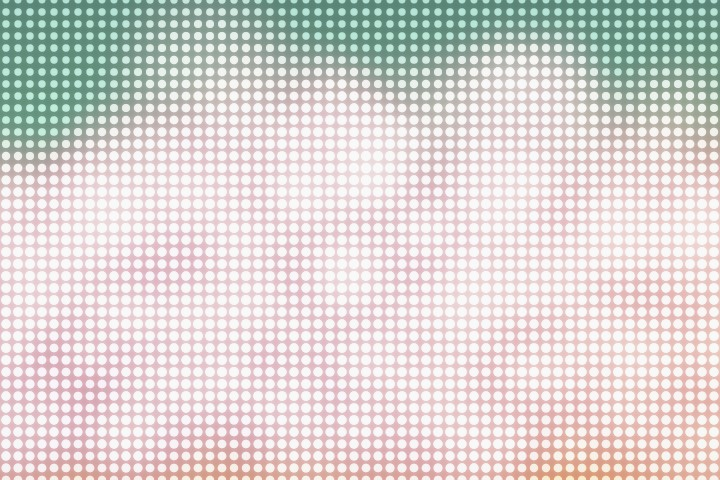 |
| **`matrix`** | **`gameboy-dither`** |
| 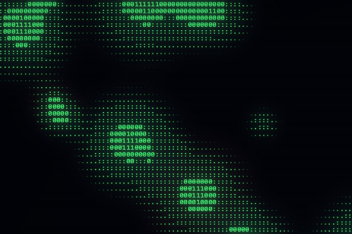 | 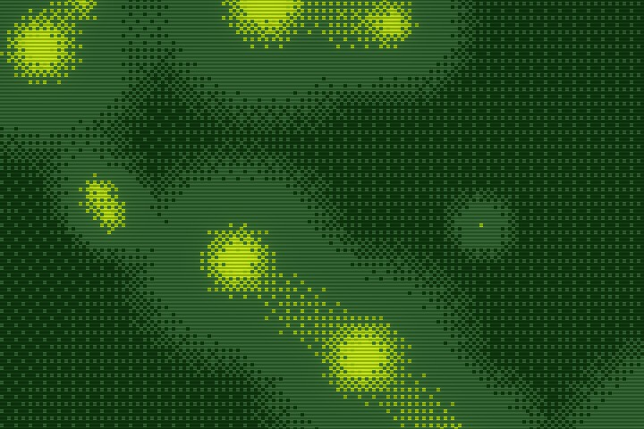 |

## The editor

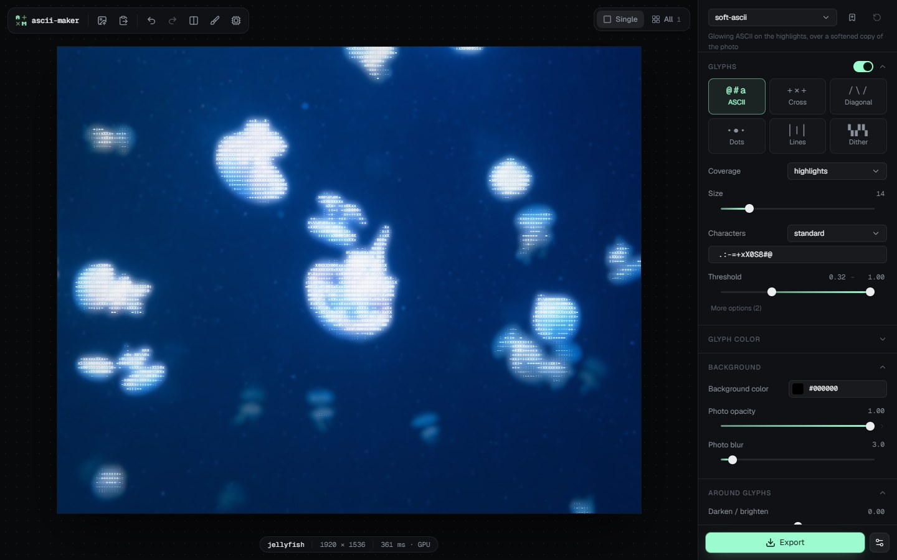

Open images or videos with **Open**, drag and drop, or paste. Pick a preset at the top of the right panel, adjust it, and press **Export**. Hovering a setting's name explains it, and changed settings are marked so you can reset them one at a time.

**Compare.** Press `\` for a before/after divider you can drag, or hold `B` to see the original.


**Mask brush.** The threshold decides where glyphs go. Where it gets a spot wrong, press `M` and paint: green adds glyphs, even on dark areas, and red removes them.

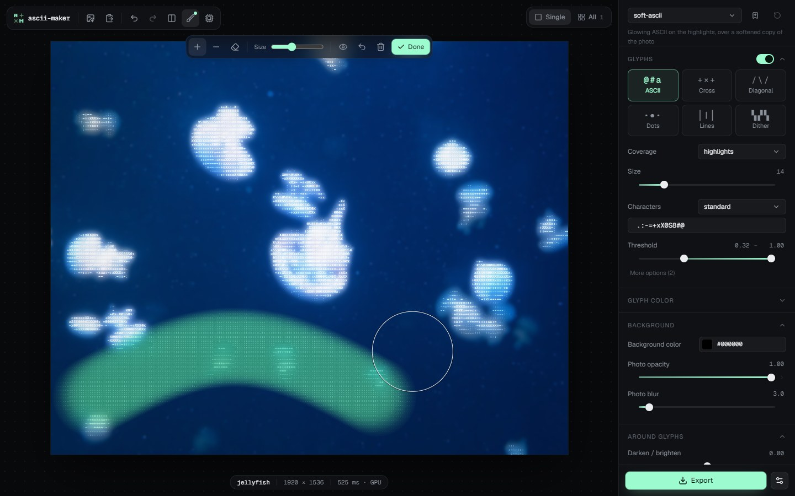

**Batches.** Load several images and press `G` to see them all rendered with the same settings. **Export all** saves them as a `.zip`.

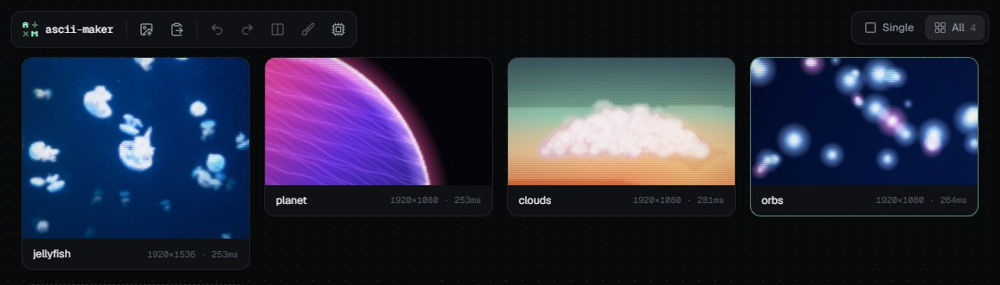

**Video.** Videos get a frame scrubber for previewing, and export as MP4 or WebM, with or without the original audio.

**Export.** PNG, JPEG or WebP, at the original size or with the long edge at 1920, 2560 or 3840 px. The export menu can also copy the plain ASCII text, copy the matching CLI command, or save the settings as JSON for the CLI.

Settings and saved presets are kept in the browser. Undo (`Ctrl+Z`) covers every change.

<details>
<summary>Keyboard and mouse</summary>

| Input | Action |
| --- | --- |
| `Ctrl+O` / `Ctrl+V` | Open / paste images |
| `Ctrl+S` / `Ctrl+Shift+S` | Export / export all |
| `Ctrl+Z` / `Ctrl+Shift+Z` | Undo / redo (undoes brush strokes while the mask brush is on) |
| `G` | Single image or all images |
| `←` / `→` | Previous / next image |
| `\` | Before/after split |
| Hold `B` | Show the original |
| `M` | Mask brush; then `A` add, `R` remove, `E` erase, `[` / `]` brush size |
| `Esc` | Leave the mask brush or the vignette picker |
| Mouse wheel, pinch, `Ctrl` + wheel | Zoom, up to 8× |
| Drag, two-finger scroll | Pan while zoomed |
| Double-click | Toggle between fit and 2.5× |

</details>

## Styles and presets

| Style | Draws |
| --- | --- |
| `characters` | Characters from a set ordered dark to bright |
| `cross` | `+` on bright cells and a small `×` on faint ones, sized by brightness |
| `diagonal` | `/` and `\` strokes that follow edges, or hatch in one direction |
| `dots` | Halftone circles that grow with brightness |
| `lines` | Vertical strokes |
| `dither` | The whole image reduced to a palette with a dither pattern |
| `photo` | No glyphs, only the photo with the adjustments and effects |

| Preset | Look |
| --- | --- |
| `soft-ascii` | ASCII on the highlights over a softened photo |
| `sharp-ascii` | ASCII over the sharp photo, slightly darkened around the glyphs |
| `cross`, `diagonal`, `dots` | The shape styles over the photo |
| `full-ascii`, `full-cross` | Every cell becomes a glyph, on black |
| `ascii-surround` | ASCII everywhere except the brightest subject, which stays a photo |
| `matrix` | Green ASCII on black with scanlines |
| `dither`, `dither-scanline`, `gameboy-dither` | Floyd–Steinberg or Bayer dither, with or without CRT scanlines |
| `scanlines` | The photo with CRT scanlines |

Character sets include `standard` (` .:-=+xX0S8#@`), `classic`, a 70-step `detailed` ramp, `blocks` (` ░▒▓█`), `braille` and `binary`, or you can type your own from dark to bright. Dithering supports error diffusion (Floyd–Steinberg, Atkinson, Jarvis, Stucki, Burkes, three Sierra variants), Bayer matrices, a halftone screen and line patterns. Palettes can be fixed (`gameboy`, `c64`, `pico8`, `cga` and others), picked from the image, or your own list of hex colors.

On top of any style: bloom, scanlines, vignette, chromatic aberration, film grain and blur.

### Where glyphs go

Glyphs are drawn on cells brighter than the **Threshold**. It has a lower and an upper end, so you can also leave the brightest parts bare; that is how `ascii-surround` keeps its subject as a photo. **Bright means** sets what a cell's brightness is compared against:

- **absolute**: nothing; its own brightness is used as is.
- **relative**: the rest of the image, so `0.7` means "the brightest 30% of cells".
- **local**: its surroundings, so flat bright areas such as sky stay bare and edges light up.

**Coverage: full** ignores the threshold and draws a glyph on every cell, like classic ASCII art.

## Command line

Needs Node 23.6 or newer, which runs the TypeScript source directly.

```bash
pnpm install
node cli/ascii-maker.ts photo.jpg -p soft-ascii -o out.png
node cli/ascii-maker.ts photo.jpg --style cross --cell-size 18 --size 4k -o out.jpg
node cli/ascii-maker.ts photo.jpg -p dither-scanline --dither-algo atkinson --palette pico8 -o out.png
node cli/ascii-maker.ts photos/*.jpg -p diagonal --size 1080p -o out/      # one output per input
node cli/ascii-maker.ts photo.jpg -p soft-ascii --mask mask.png -o out.png  # white adds glyphs, black removes
node cli/ascii-maker.ts clip.mp4 -p soft-ascii --size 1080p -o clip-ascii.mp4
node cli/ascii-maker.ts --list   # presets, styles, character sets, dither algorithms, palettes
node cli/ascii-maker.ts --help   # every flag with its range and default
```

Every editor setting is a flag in kebab-case (`cellSize` becomes `--cell-size`). They apply in this order: defaults, `--preset`, `--config` (a JSON file, such as one saved from the editor), then individual flags. Invalid values fail with an error that names the allowed range. `--text out.txt` also writes the plain character grid, and `--json` prints a summary per file.

Video needs ffmpeg on `PATH` (or `FFMPEG_PATH`). Frames are rendered across all CPU cores and encoded to MP4, WebM or GIF with the audio kept; `--fps`, `--start`, `--duration`, `--crf` and `--no-audio` control the output. A 30-second 1080p clip takes about half a minute on a Ryzen 7 9800X3D.

## How it works

The pipeline is in [`src/engine/`](src/engine). Everything runs in floating point, with each color channel from 0 to 1.

1. Adjust brightness, contrast, saturation and gamma.
2. Split the image into cells (0.6 as wide as tall for characters, square otherwise) and average each cell's color.
3. Turn each cell's luminance into a level between the threshold's two ends, with a smoothstep fade so glyphs grow in rather than switch on. A painted mask raises or lowers it per cell.
4. Pick a glyph per cell from its level: a character from the set, a cross's arm length, a dot's radius. Each distinct glyph is drawn once into an alpha mask and then stamped into every cell that uses it, which is much faster than drawing each cell through a canvas. For `diagonal`, a Sobel filter sets the stroke direction.
5. Draw the glyphs over the photo, which can be blurred, faded toward a background color, or darkened and blurred only around the glyphs.
6. Add bloom (a soft bright-pass, blurred at two radii), color fringe, scanlines, vignette and grain.

Dither replaces steps 2 to 5: the image is shrunk to the pixel size, reduced to the palette, and scaled back up with hard edges.

Sizes are measured on a 1920 px-wide image and scale with the output, so a 4K export looks like the preview, only sharper.

In the browser, rendering runs in Web Workers. By default the pixel passes and the glyph stamping run as WebGL2 shaders (`src/engine/gpu/`), and the result goes to the screen without being read back. The CPU path is the fallback, and the GPU tests check it against the shaders on every preset and style.

## Development

```bash
pnpm dev         # editor at http://localhost:5173
pnpm test        # engine, CLI and zip tests
pnpm test:gpu    # WebGL2 renderer vs the CPU, and video export, in headless Chromium
pnpm typecheck
pnpm build       # static site in dist/
node scripts/examples.ts --photo photo.jpg   # regenerate public/examples/
node scripts/screenshots.ts                  # regenerate the screenshots in docs/
```

`pnpm test:gpu` and the screenshot script need Playwright's Chromium once: `pnpm exec playwright-core install chromium-headless-shell`.

The planet, clouds and orbs images are generated (`src/samples/scenes.ts`). The editor uses React, [Radix UI](https://www.radix-ui.com/) and Tailwind CSS, and deploys to GitHub Pages on every push to `main`.
